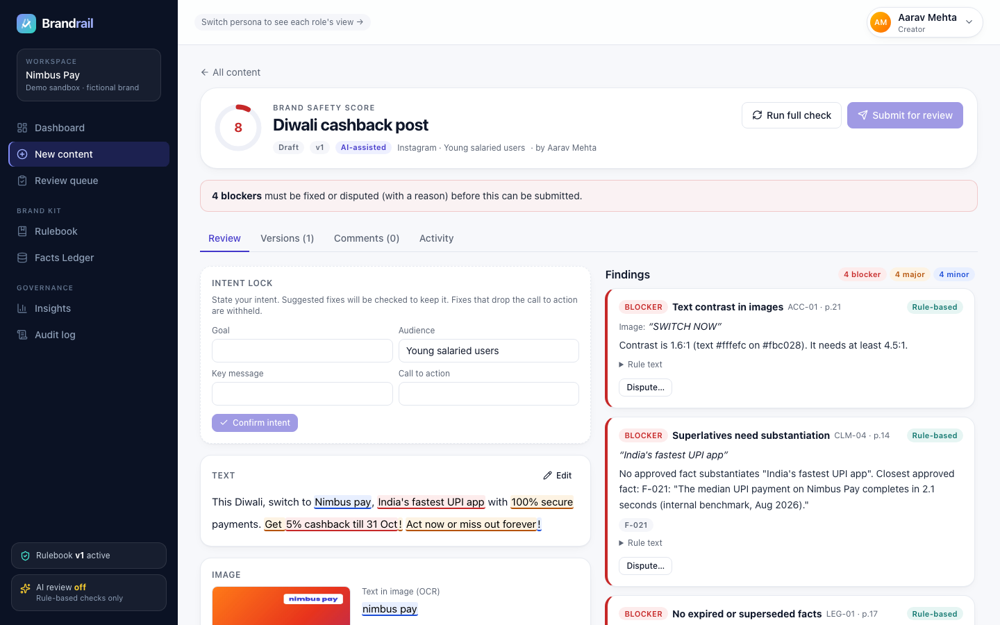
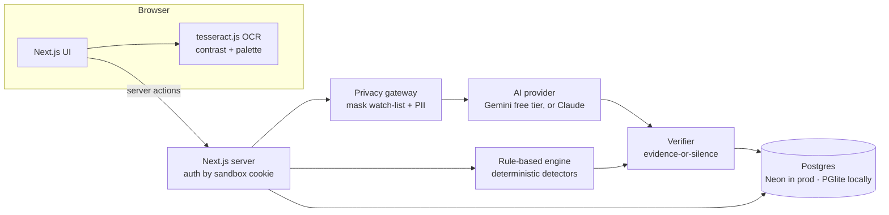

# Brandrail

**Guardrails, not gatekeepers.** Brandrail is a pre-publication brand-governance platform. It checks every word, image and claim against an organisation's approved guidelines and facts before anything goes out. Every flag cites the rule or fact behind it, every suggested fix is checked to keep the creator's intent, and a person always makes the final call.

Built for the **Inkloom AI brand-governance problem statement** (We Code Coders hackathon) by team **Caffiene Addict**.



## Try it in 3 minutes

The demo needs no sign-up. Each visitor gets a private sandbox with a fictional brand, **Nimbus Pay** (an Indian payments app): a 29-rule rulebook with page citations, a Facts Ledger with expiry dates, and some seeded review history. Switch persona from the top bar.

1. **New content** → load the *Diwali cashback post* sample → **Check content**. You'll see cited findings: an expired offer (in the caption *and* inside the image), an unsupported "India's fastest" claim, "100% secure", fear-based urgency, and CTA text in the image with a 1.6:1 contrast ratio.
2. **Accept** a few fixes. Each creates a new version and re-checks instantly. **Dispute** the findings you disagree with, giving a reason.
3. **Submit for review**. Switch to **Meera (brand reviewer)**: override or reject disputes, then approve. Switch to **Kabir (Compliance)**: claims and legal blockers are his call. When every required role has approved, the version is locked as **Brandrail Verified** (SHA-256, rulebook version, approvers).
4. Open **Insights** (Guideline Health shows which rules people keep disputing) and the **Audit log** (the hash chain is re-verified on every view).
5. As **Ishita (brand admin)**: edit a rule (this publishes a new rulebook version and re-checks content in progress), or **Import guidelines** with the sample festive-campaign PDF to watch the Rule Compiler draft rules that quote their source page.

## What it does

| Area | What's built |
|---|---|
| **Brand Rulebook** | Atomic rules with ID, category, severity, examples and source page. Versioned: every edit publishes v*n*+1, findings and approvals are pinned to the version they used, and content in progress is re-checked. **Rule Compiler**: upload brand guidelines (PDF/DOCX/TXT); Claude drafts rules and must quote the page each comes from; drafts whose quote isn't on that page can't be published; the admin approves each one. |
| **Facts Ledger** | Approved claims (figures, offers, ratings, certifications) with evidence, owner and valid-until date; superseded facts point to their replacement. CSV import. Terminology (preferred/banned/competitor) and a confidential watch-list. |
| **Content intake** | Pasted text, DOCX, PDF, and images (PNG/JPG). Images are analysed **in the browser**: OCR (two passes, the second on a saturation map so low-contrast text is still read), WCAG contrast per text line, dominant colours. |
| **Review Engine** | Rule-based checks plus a grounded AI review, followed by the evidence-or-silence verifier (see below). Findings show quote, rule, page, fact codes, severity, method (*Rule-based* / *AI-assisted* + confidence). |
| **Fix Studio** | Inline highlights; accept a fix (new version + instant re-check), dispute with a reason, withdraw a dispute; edit by hand; intent card (extracted by Claude Haiku, confirmed by the creator). |
| **Approval workflow** | Roles: creator, brand reviewer, compliance, brand admin. Claims/legal/confidentiality findings automatically add Compliance as a required approver, and only Compliance can override those. Overrides need a reason. Request changes, rounds, version diffs, comments, Brandrail Verified record with export. |
| **Insights** | Issues by category and by who wrote the content (employee / agency / AI tool), first-round approval rate, verifier keep-rate, expiring facts, **Guideline Health** (rules that are often disputed, often overridden, or clear but repeatedly broken). |
| **Audit log** | Append-only, SHA-256 hash-chained events. The chain is recomputed and verified on every view. |

## Architecture



**Stack:** Next.js 15 (App Router, server actions, TypeScript) · Tailwind CSS 4 · Drizzle ORM · Postgres (Neon on Vercel; embedded PGlite for local development) · Google Gen AI SDK and Anthropic TypeScript SDK behind one provider interface · tesseract.js · unpdf · mammoth · diff · lucide-react.

### The hard part: AI findings people can trust

A brand checker fails if it invents rules, misquotes text or over-flags, because people learn to ignore it. Brandrail treats the model as one stage of a pipeline that code checks:

1. **Rule-based first.** 24 of the 29 rules have deterministic detectors: terminology, banned words, competitor names, watch-list leaks, personal data, unverified figures (any number not in an in-date fact), expired or superseded facts (with the aligned replacement suggested), superlatives without substantiation, green claims, regulator endorsements, missing disclaimers, tagline form, exclamation/caps/emoji limits, readability, alt text, WCAG contrast in images, palette distance (CIEDE2000). Same text + same rulebook = same result.
2. **Privacy gateway.** Watch-list terms and personal data are replaced with placeholders before any text leaves the server, and restored afterwards.
3. **Grounded AI review.** The model (Gemini on the free deployment, Claude Sonnet 5.5 when configured) receives the rulebook and Facts Ledger (cached where the provider supports it), the content, the confirmed intent and the rule-based findings, and returns schema-bound JSON. Each finding must carry an exact quote, a rule code, any fact codes and a replacement for the quoted span. Its job is the part that needs judgement: tone, messaging, audience fit and implied claims.
4. **Verifier (evidence-or-silence).** An AI finding is dropped if its rule doesn't exist in the active version, its quote isn't in the text, its confidence is below 0.5, or it duplicates a rule-based finding (its rewrite is merged into the rule-based finding when that one had none). Rewrites are re-checked: a rewrite is withheld if it adds a figure not in the Facts Ledger, drops the confirmed call to action, or makes a rule-based check fail. Every dropped item and the reason is shown under *How this was checked*.
5. **Humans decide.** Nothing is auto-applied or auto-approved. Severity comes from the rule, not from the model.

### Main technical decisions

- **One deployable app.** The Round 1 plan had a separate FastAPI backend. For a solo build that judges must be able to open instantly, a single Next.js app on Vercel removes cold starts on a second host, CORS and a second deploy. The engine is plain TypeScript, so the same code runs in the server, the eval harness and the tests.
- **Postgres via Drizzle, with PGlite locally.** One schema, real SQL in production (Neon) and a zero-setup embedded database for development. Migrations are embedded and applied at runtime under an advisory lock.
- **Sandbox per visitor instead of accounts.** Judges must reach the product without signing in, so each visitor gets an isolated workspace (unguessable ID in an httpOnly cookie) and switches between four personas. Role permissions are enforced on the server in every action.
- **OCR in the browser.** Images never need to leave the user's machine for OCR, contrast or palette analysis, and the server stays light.
- **Provider-agnostic AI layer, free by default.** All AI calls go through one structured-output interface (`src/lib/ai/structured.ts`). With an Anthropic key it uses Claude (Sonnet 5.5 for review, Haiku 5.5 for intent, with prompt caching and server-side refusal fallback). Without one it uses Google Gemini's free tier (`gemini-flash-latest`), so the hosted demo costs nothing to run. Without either it runs rule-based checks only and says so. The verifier treats every provider's output the same way.
- **Whole-rulebook prompting with caching instead of vector retrieval.** A rulebook of ~30 rules and ~15 facts fits comfortably in context. Sending all of it (cached) is more accurate than top-k retrieval at this size. pgvector retrieval is planned only if rulebooks grow large.

## Evaluation

`npm run eval` scores the engine against a labelled golden set (`eval/golden.ts`: 44 samples, 12 of them clean controls). `npm run eval -- --ai` adds the Claude review and the verifier. Latest rule-based-only result ([docs/eval-report.md](docs/eval-report.md)):

| Metric | Rule-based only |
|---|---|
| Precision | 100% (52 TP / 0 FP) |
| Recall | 90% (all 6 misses are tone/messaging/implied-claim labels that need the AI review) |
| Blocker precision / recall | 100% / 97% |
| False flags on clean controls | 0 |
| Citation validity | 100% |

These numbers are optimistic: the golden set was written alongside the rules. Round 3 adds independently written samples and real user content.

## Models, APIs, libraries and services

| Item | Use |
|---|---|
| Google Gemini API (free tier), `gemini-flash-latest` / `gemini-flash-lite-latest` | Default AI provider on the hosted demo: content review, Rule Compiler, intent extraction (JSON-schema output) |
| Anthropic Claude API, `claude-sonnet-5-5` / `claude-haiku-5-5` | Used instead of Gemini when an Anthropic key is configured (structured output, prompt caching, server-side refusal fallback) |
| tesseract.js (Apache-2.0) | In-browser OCR |
| unpdf, mammoth | PDF and DOCX text extraction |
| Drizzle ORM, postgres.js, PGlite | Database access, local embedded Postgres |
| Next.js, React, Tailwind CSS, lucide-react, diff, zod | App framework, UI, word diffs, schemas |
| Vercel + Neon | Hosting and Postgres |

**Data:** all demo data (the Nimbus Pay brand book, facts, sample content, sample creative and guidelines PDF) is fictional and was created for this project. No real company's material is used.

**Screenshots:** [landing](docs/screenshots/landing.png) · [dashboard](docs/screenshots/dashboard.png) · [review](docs/screenshots/review.png) · [verified](docs/screenshots/verified.png) · [insights](docs/screenshots/insights.png)

**Templates and AI assistance (disclosure):** the project was started from `create-next-app` (boilerplate). It is a solo build, and the implementation was written with heavy use of **Claude Code** (Anthropic's AI coding assistant) under the author's direction. Commits made with it carry a `Co-Authored-By: Claude` trailer.

## Privacy and security

- **Text sent to the AI:** only masked text is sent to the AI provider (watch-list terms, emails, phone, Aadhaar-like and PAN-like numbers become placeholders). OCR, contrast and colour analysis run in the browser.
- **Free-tier caveat:** on Gemini's free tier, Google may use submitted text to improve its products. That is acceptable for this demo (masked, fictional data), but a real deployment handling confidential material should use a paid tier or Claude.
- **Sandbox access:** each sandbox is reachable only through its unguessable ID in an httpOnly, SameSite cookie. Every server action re-checks the workspace and the persona's permissions.
- **Overrides:** an override always needs a reason, and only the owning role may give it (Compliance for claims, legal and confidentiality).
- **Audit log:** append-only and hash-chained.
- **Secrets:** none are in the repository. `.env*` files are git-ignored. See `.env.example`.

## Known limitations

- Logo misuse (VIS-02) is not checked automatically yet: it is listed in the rulebook and left to the reviewer.
- OCR quality varies on stylised fonts; creators can correct the OCR text before checking.
- Personas are a demo convenience, not real authentication.
- English only. The golden set is still small (44 samples).

## Run locally

```bash
git clone https://github.com/n1h4r1k4/brandrail.git && cd brandrail
npm install
cp .env.example .env.local   # optional: add a free GEMINI_API_KEY (aistudio.google.com) to enable the AI review
npm run dev                  # http://localhost:3000, uses an embedded PGlite database in ./.data
npm run eval                 # rule-based evaluation; add -- --ai for the AI review
```

**Deploy (free):** import the repo in Vercel (Hobby plan), add a Neon Postgres database from the Storage tab (free plan; this sets `DATABASE_URL`), and add `GEMINI_API_KEY` as an environment variable. Migrations run automatically on the first request.

## Contribution

Solo project by **Niharika Sharma** (team Caffiene Addict), who owns the product direction, scope decisions, testing and submission. The implementation, the fictional demo brand kit, the evaluation set and this documentation were produced with Claude Code (Anthropic's AI coding assistant) working under her direction. See the disclosure above.

## License

GPL-3.0. See [LICENSE](LICENSE).
